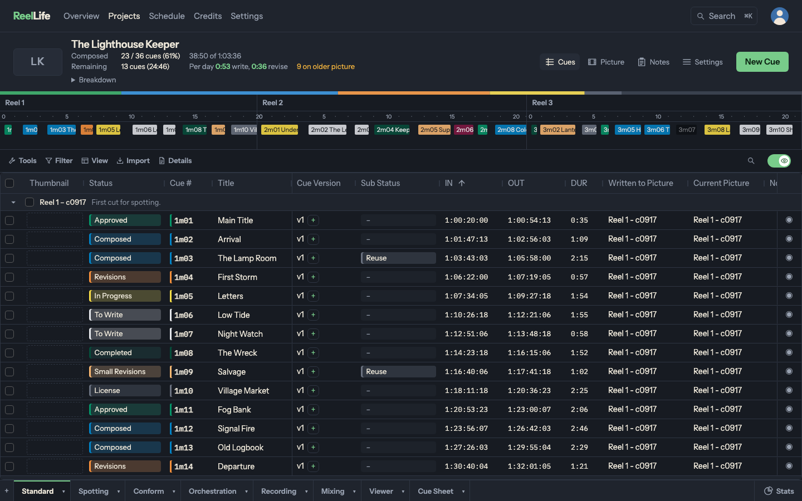
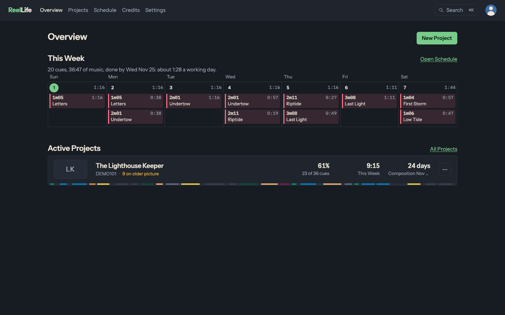
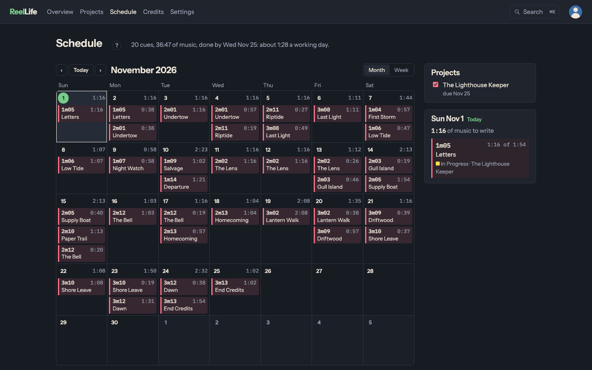

# ReelLife

[](https://github.com/nhadler/reellife/actions/workflows/ci.yml)
[](https://github.com/nhadler/reellife/releases)
[](https://github.com/nhadler/reellife/pkgs/container/reellife)
[](LICENSE)

Self-hosted cue tracking and project management for film and TV composers.



## Features

- **Cue tracking:** Manage cues across reels in an editable grid, with statuses, timecodes, picture versions, and undo support. Includes separate views for spotting, conforming, orchestration, recording, mixing, and cue sheets. Supports arbitrary frame rates, including drop-frame.
- **Cue versions:** Keep multiple versions of a cue, each with its own notes, themes, and associated picture.
- **Import:** Bring in cues from Pro Tools (Session Info as Text, clips, or markers), Cubase, Nuendo, MIDI markers, Excel, or CSV. Review additions and changes before importing.
- **Conform:** Track cues against picture revisions and shift timecodes by reel when a new cut arrives.
- **Export:** Generate Excel and CSV cue logs, PDF reports, and RapidCue cue sheets with writer and publisher splits.
- **Scheduling:** Plan writing across projects based on cue difficulty and deadlines.
- **MCP:** An [MCP](https://modelcontextprotocol.io) endpoint at `/mcp` allows AI assistants to access and edit project data using the same permissions as regular users.
- **Authentication:** OIDC login with PKCE and group-based roles. Includes a restrictive Content Security Policy and runs in a read-only container as a non-root user.

| Overview | Schedule |
|---|---|
|  |  |

## Installation

ReelLife runs with Docker Compose and requires an OIDC identity provider. It's tested with [PocketID](https://pocket-id.org), but other providers that include a `groups` claim should work.

```bash
mkdir reellife && cd reellife
curl -fsSLO https://raw.githubusercontent.com/nhadler/reellife/main/deploy/docker-compose.yml
curl -fsSL https://raw.githubusercontent.com/nhadler/reellife/main/deploy/.env.example -o .env

# Configure .env with your secret key, hostname, and OIDC settings
docker compose up -d
```

By default, ReelLife listens on `127.0.0.1:8000`. You'll need a reverse proxy with TLS, such as Caddy, Traefik, or Tailscale Serve.

Container images are available for `linux/amd64` and `linux/arm64` at [ghcr.io/nhadler/reellife](https://github.com/nhadler/reellife/pkgs/container/reellife). Images are tagged with their release version (`1.5.2`, `1.5`, `1`) and `latest`.

To pin a specific version, set the following in `.env`:

```env
REELLIFE_IMAGE=ghcr.io/nhadler/reellife:1.5.2
```

See [deploy/README.md](deploy/README.md) for OIDC configuration, environment variables, backups, upgrades, and installation without Docker (systemd + uv).

## Development

Requires [uv](https://docs.astral.sh/uv/), [just](https://just.systems/), and Node.js 22.

```bash
just setup    # Install dependencies and git hooks
just dev      # Start the development server at localhost:8000
just seed     # Populate a demo project
just lint     # Run linting, type checks, and security checks
just cov      # Run tests with branch coverage
```

The development server uses a mock identity provider, so you don't need to configure OIDC locally.

### Stack

ReelLife uses Django 6.1 with server-rendered templates, HTMX, Alpine.js (CSP build), AG Grid Community for the cue grid, and TipTap for writing notes. SQLite handles storage.

Timecodes are stored as integer frame counts at the project's nominal frame rate rather than as formatted strings.

See [CONTRIBUTING.md](CONTRIBUTING.md) before submitting a pull request.

## Status

ReelLife is under active development.

Releases and changes are documented in [CHANGELOG.md](CHANGELOG.md). Until 1.0, minor releases may include breaking changes. Database migrations run automatically during upgrades, with any required manual steps noted in the changelog.

## Security

Please report vulnerabilities privately following [SECURITY.md](SECURITY.md).

## License

ReelLife is licensed under the [GNU Affero General Public License v3.0 or later](LICENSE) (AGPL-3.0-or-later).

If you run a modified version as a network service, the AGPL requires you to make the corresponding source code available to its users. Set `REELLIFE_SOURCE_URL` to link to your source from the application's Help page.

Third-party licenses are listed in [NOTICE.md](NOTICE.md).
